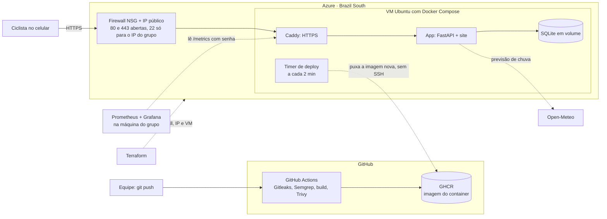

# CicloAlerta — MVP (Global Solution 2026.2 · CitizenTech)

## Ficha Técnica do MVP

| Campo da ficha | Conteúdo |
| --- | --- |
| Nome do produto | CicloAlerta *(nome provisório)* |
| Cidadão e território | Ciclistas e entregadores de bicicleta elétrica nas ciclovias da cidade de São Paulo |
| Problema, em uma frase | Buracos e desníveis nas ciclovias causam quedas, e na chuva ficam escondidos pela água |
| Proposta de valor | Saber antes de sair, e durante o trajeto, onde estão os trechos perigosos, com alerta mais forte em dia de chuva |
| Arquitetura: componentes | Site + API (FastAPI), detector de buracos (YOLO), assistente (LLM local com RAG), pipeline de dados (Airflow + Databricks), bot de triagem (Python), robô com sensor (ESP32), tudo publicado com Docker, Terraform e CI/CD |
| Fontes de dados | Open-Meteo (chuva), malha cicloviária do GeoSampa, relatos feitos no próprio MVP (com parte simulada e documentada) |
| Modelos de IA utilizados | YOLO treinado para buracos; LLM local pequeno via Ollama com busca em base de conhecimento |
| URL do MVP e repositório | https://cicloalerta.brazilsouth.cloudapp.azure.com · https://github.com/jonzaka/gs-citizentech-app |
| Indicadores de impacto | Perigos mapeados, % de relatos confirmados, alertas enviados em dias de chuva, tempo até o perigo ser resolvido |
| ODS conectados | ODS 11 (cidades sustentáveis, transporte seguro), ODS 3 (saúde, menos acidentes de trânsito), ODS 9 (infraestrutura) |

## Integrantes

| Nome completo | RM |
| --- | --- |
| Joel Barros | RM550378 |
| *(preencher)* | |

## Arquitetura



## O que há neste repositório

Este é o repositório `app`: o site, a API e todo o caminho até a nuvem (disciplina Secure DevOps Tools & Cloud Computing).

```
app/                  API em FastAPI e o site (HTML + Leaflet)
Dockerfile            imagem em duas etapas, usuário não root
compose.yaml          stack local: app + Prometheus + Grafana
compose.prod.yaml     stack da nuvem: app + Caddy (HTTPS)
infra/terraform/      a nuvem descrita em código (Azure)
monitoring/           configuração do Prometheus e do Grafana
.github/workflows/    pipeline DevSecOps
```

## Rodar na sua máquina

Precisa só do Docker.

```bash
git clone https://github.com/jonzaka/gs-citizentech-app.git
cd gs-citizentech-app
docker compose up --build
```

- Site e API: http://localhost:8000 (documentação das rotas em `/api/docs`)
- Prometheus: http://localhost:9090
- Grafana: http://localhost:3000 (usuário `admin`; senha definida em `.env`, veja `.env.example`)

## Contrato da API

| Rota | O que faz |
| --- | --- |
| `GET /api/relatos` | Lista os perigos (lat, lon, tipo, severidade, origem, data) |
| `POST /api/relatos` | Cria um relato; `origem` é `app`, `visao` ou `robo` |
| `POST /api/detectar` | Recebe uma foto e devolve as detecções *(em integração)* |
| `POST /api/perguntar` | Recebe uma pergunta e devolve `resposta`, `fonte` e `consta` *(em integração)* |
| `GET /api/clima` | Diz se chove agora e na próxima hora (Open-Meteo) |
| `GET` e `POST /api/alertas` | Alertas de trecho crítico; o `POST` pede o cabeçalho `X-API-Key` |
| `GET /api/indicadores` | Indicadores da tabela Ouro (`app/dados/indicadores.csv`), mostrados na tela `/indicadores.html` |
| `GET /health` e `GET /metrics` | Saúde do serviço e métricas para o Prometheus |

## Como o código chega à nuvem

1. A cada push, o GitHub Actions roda **Gitleaks** (segredos), **Semgrep** (código inseguro), constrói a imagem e roda o **Trivy** (vulnerabilidades). Qualquer falha barra o pipeline.
2. Na branch `main`, a imagem aprovada vai para o registro do GitHub (GHCR).
3. A VM confere a cada 2 minutos se há imagem nova e atualiza sozinha. O pipeline não entra na VM, então a porta 22 não precisa abrir para a internet.
4. O último passo do pipeline espera a URL pública responder com a versão do commit.

## Observabilidade

O Prometheus e o Grafana rodam na máquina do grupo (`docker compose up`) e leem as métricas do MVP publicado na nuvem.

- **Dashboard** "MVP CicloAlerta - 4 métricas de ouro", em http://localhost:3000, pasta MVP: latência (p50, p95, p99), tráfego (requisições por segundo, por rota), erros (respostas 4xx e 5xx) e saturação (CPU e memória do app em relação ao limite).
- **Alertas**, em `monitoring/grafana/provisioning/alerting/regras.yml`:
  - *MVP fora do ar*: o Prometheus fica 1 minuto sem conseguir ler o MVP.
  - *MVP com muitos erros 5xx*: mais de 20% das respostas são erro do servidor por 2 minutos.
- O `/metrics` da nuvem pede usuário e senha. Para o Prometheus local ler, salve a senha em `monitoring/secrets/metrics_password` (pasta fora do git). Sem esse arquivo, o dashboard continua funcionando com o ambiente `mvp-local`.

Tudo é criado por arquivo (dashboard, fonte de dados e regras), sem clicar na interface.

## Recriar a nuvem do zero

Precisa do Terraform e do Azure CLI com `az login` feito.

```bash
cd infra/terraform
cp terraform.tfvars.example terraform.tfvars   # preencha com os seus valores
terraform init
terraform apply
```

O Terraform cria o grupo de recursos, a rede, o firewall (portas 80 e 443 abertas; porta 22 só para o IP informado), o IP público com nome DNS e a VM. Na primeira inicialização, a VM instala o Docker e liga o deploy automático. O `terraform.tfstate` e o `terraform.tfvars` ficam fora do repositório.

## Segurança e LGPD

- Nenhum segredo no código ou na imagem: tudo entra por variável de ambiente ou GitHub Secrets.
- O container roda sem root, com sistema de arquivos somente leitura e sem privilégios extras.
- O site não tem login. O banco guarda só o ponto do perigo (latitude e longitude arredondadas, tipo, gravidade, origem e data). Não guardamos trajeto, IP nem identificação de quem reportou.
- Os dados ficam em um volume da VM, na região Brazil South (São Paulo).
- Os pontos de exemplo que aparecem no mapa estão marcados como `simulado`.

## Responsabilidade compartilhada

O MVP usa uma VM (infraestrutura como serviço). O Azure protege o datacenter, o hardware, a rede do provedor e a virtualização. O grupo protege do sistema operacional para cima: regras do firewall, acesso à VM (só chave SSH), imagem do container, código, segredos e os dados dos cidadãos.

## Custo estimado

Preços de tabela do Azure em Brazil South, consultados em 17/11/2026.

| Recurso | US$ por mês |
| --- | ---: |
| VM Standard_D2s_v4 (2 vCPU, 8 GB), 730 h a US$ 0,153/h | 111,69 |
| Disco SSD Standard E4 (32 GB) | 4,48 |
| IP público estático | 3,65 |
| Tráfego de saída (dentro dos 100 GB gratuitos), GitHub Actions e GHCR | 0,00 |
| **Total** | **119,82** |

Na Global Solution a VM fica ligada cerca de 10 dias, o que dá perto de US$ 39, pagos com crédito de estudante. A assinatura de estudante não libera a série B em Brazil South; com uma Standard_B2s o total cairia para cerca de US$ 57 por mês.
